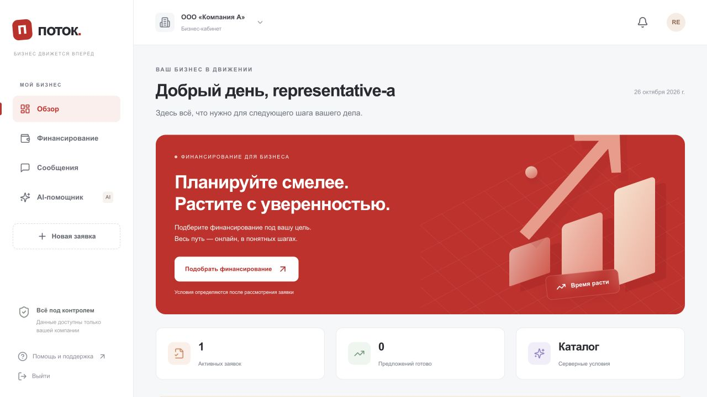
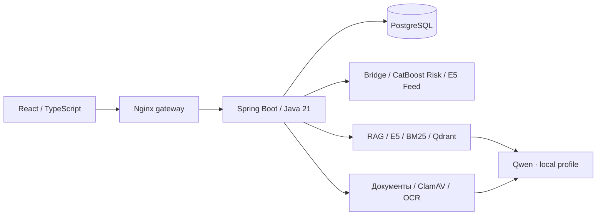

# Поток

### Умный кредитный кабинет предпринимателя

**Gambit_Yvaga · Альфа Хак 2026**

Потребность в финансировании, заявка, документы, рассмотрение и результат — в одном веб-кабинете. Предприниматель видит сохранённые данные, текущий статус и следующий шаг. Банк получает связанный демонстрационный конвейер с отдельными скорингом и кредитной политикой.

**[Открыть демо](https://president-diameter-endearing.ngrok-free.dev)** · **[Документация для жюри](docs/jury/README.md)** · **[Архив для жюри](docs/jury/presentation/potok-gambit-yvaga-submission.zip)** · **[PDF](docs/jury/presentation/potok-gambit-yvaga.pdf)** · **[PPTX](docs/jury/presentation/potok-gambit-yvaga.pptx)** · **[Версия сдачи](https://github.com/Tonitrus1/ALFA-HACK-2026/tree/submission-2026-10-26-r2)**



## Что работает

- Сквозной путь: продукт, черновик, финансы, подача, рассмотрение, уточнение/решение, предложение, принятие и демооформление.
- PostgreSQL, версии и неизменяемые снимки, фоновые задания, идемпотентность команд и изоляция компаний.
- CatBoost Risk и отдельная Java DemoPolicyV1: одобрение, другие условия, уточнение, отказ или MANUAL.
- Документы: карантин, настоящий ClamAV, OCR-кандидаты с источниками и подтверждением пользователем. Ручной ввод доступен.
- Персональная лента E5 с предпочтениями, реакциями и сохранением материалов. Feed v2/CatBoost и synthetic antifraud — явно включаемые эксперименты.
- RAG-ассистент с E5/BM25, Qdrant, источниками и контекстом компании. Локальная Qwen позволяет обойтись без платного API.


## 1. Проверить онлайн

Откройте **https://president-diameter-endearing.ngrok-free.dev**. При первом визите ngrok может показать страницу с кнопкой **Visit Site** — после неё откроется вход в «Поток».

| Логин | Пароль публичного синтетического демо |
|---|---|
| `company-a` | `xc-fWfKQYhasOO_xpEB4h3VFXHHA9HAv8YlunS2YM8VLvqJ4` |
| `company-b` | `5ykMqYlqwkXTGc8cqGKYDz8hwBeHT89LzPpDQL3l-ecI5MrJ` |


Кабинеты общие и могут содержать синтетические заявки других проверяющих. Доступность зависит от сервера и ngrok-туннеля. Локальный запуск воспроизводится по Git независимо от туннеля.


## 2. Запустить у себя

Нужны **Git**, **Docker с Linux containers**, **Compose v2.20+**, **Python 3.10+** и интернет для первой сборки/моделей. Java/Node/ML-библиотеки на хосте для Docker-запуска не нужны.

```sh
git clone https://github.com/Tonitrus1/ALFA-HACK-2026.git
cd ALFA-HACK-2026
git checkout submission-2026-10-26-r2
python3 scripts/deploy.py init
python3 scripts/deploy.py doctor
python3 scripts/deploy.py up --mode local
```

**Windows:** замените `python3` на `python`. **Адрес кабинета:** http://127.0.0.1:8080.

`init` создаёт случайные локальные пароли в **`.local/cabinet-access.md`**. Используйте их вместо паролей серверного демо. Повторная настройка сохраняет существующие секреты.

`local` запускает полный стек с Docker Ollama и открытой Qwen2.5 3B для ассистента/OCR. Платный API не требуется. Первая подготовка скачивает образы, E5, tokenizer и LLM. Повторный запуск использует постоянные volumes.

Для небольшой нагрузки предусмотрена конфигурация 8 vCPU / 16 GB RAM / 160 GB SSD, но ёмкость всего CPU-стека на такой VM не подтверждена. OCR и чат делят одну модель и могут ждать друг друга. Qwen2.5 3B имеет **Qwen Research License**: коммерческое внедрение требует отдельного решения по лицензии.

Для облегчённой проверки основного пути с ручным вводом финансов:

```sh
python3 scripts/deploy.py up --mode core
```

Ориентир для core — от 8 GB Docker RAM и 30 GB свободного диска. Дополнительный `--mode full` использует ваш внешний OpenAI-compatible endpoint/key и не обязателен для бесплатной проверки. Без модели успешная генерация OCR/ассистента не подразумевается.

**[Все профили, переменные и диагностика](docs/jury/deployment.md)**. Отдельный поддерживаемый вариант с Caddy/HTTPS: [Selectel](deploy/selectel/README.md). Его конфигурация не приписывается автоматически текущему ngrok-стенду.

## 3. Пройти основной сценарий

1. Войти, выбрать оборотный кредит для закупки: **500 000 ₽ на 12 месяцев**.
2. Создать заявку: срок работы **40 месяцев**, предварительная выручка **3 000 000 ₽**.
3. При желании загрузить синтетический документ и сверить OCR. Можно перейти к ручному вводу.
4. Период — **2025 год**. Заполнить и подтвердить все восемь значений:

| Показатель | Значение |
|---|---:|
| Активы | 1 000 000 ₽ |
| Обязательства | 400 000 ₽ |
| Оборотные активы | 500 000 ₽ |
| Краткосрочные обязательства | 200 000 ₽ |
| Капитал | 600 000 ₽ |
| Выручка | 3 000 000 ₽ |
| Чистая прибыль | 100 000 ₽ |
| EBIT | 150 000 ₽ |

5. Отправить заявку и дождаться результата. Для контрольного набора при доступном baseline Risk ожидается предварительное одобрение.
6. Открыть предложение, принять условия и завершить **демооформление**. Обновить страницу и проверить сохранение результата.
7. Настроить ленту, открыть статью, сохранить полезный материал. Задать ассистенту вопрос по документам и проверить источники.

**[Таблица значений для всех четырёх развилок](docs/jury/demo.md#четыре-проверяемые-развилки)**: одобрение, отказ, ручная проверка и другие условия. 

## 4. Архитектура и структура



Backend — модульный монолит; ML/OCR/RAG — отдельные процессы. Сессии и доставка бизнес-событий используют PostgreSQL, документы — версионированный файловый том. Redis/Kafka/S3 базовой поставкой не запускаются. Qdrant подключён как настоящий сервис. БКИ, KYC/AML, АБС, ЭП и реальная выдача требуют интеграции.

| Каталог | Назначение |
|---|---|
| `frontend/` | React, API adapter, unit/браузерные тесты |
| `backend/` | Java-модули, migrations, ports/adapters |
| `ml/` | Risk, Feed, bridge, OCR, assistant, model cards |
| `deploy/`, `compose.yaml` | Образы, gateway и overlays |
| `scripts/` | Подготовка, запуск, обучение и проверки |
| `datasets/` | Синтетический датасет и описание происхождения |
| `docs/jury/` | Актуальная документация сдачи и презентация |
| `docs/architecture/` | Историческая архитектура и проектные контракты |
| `reports/` | Датированные результаты прежних проверок |

**[Текущая архитектура](docs/jury/architecture.md)** · **[Модель данных](docs/jury/data-model.md)** · **[Развитие для банка](docs/jury/bank-roadmap.md)**

## 5. API и проверки

**[Описание API](docs/jury/api.md)** · **[OpenAPI 3.1](docs/jury/api/openapi.json)** · **[Postman](docs/jury/api/potok.postman_collection.json)**

Browser использует cookie, CSRF и версию контекста компании. Деньги передаются целыми копейками. Изменения проверяют ETag, повторяемые команды — Idempotency-Key. Внутренние AI endpoints и токены не предназначены для браузера.

```sh
python3 -m unittest discover -s scripts -p 'test_*.py'
python3 scripts/jury/validate.py
# Smoke создаёт синтетическую заявку: запускать на отдельной установке
python3 scripts/integration/smoke.py --output reports/manual-smoke.json
# Разработка UI: Node 22 и npm ci в frontend
npm --prefix frontend run build
npm --prefix frontend test
npm --prefix frontend run lint
# Backend: Java 21; для embedded PostgreSQL использовать LC_ALL=C и LANG=C
./backend/mvnw -B -ntp -f backend/pom.xml verify
```


