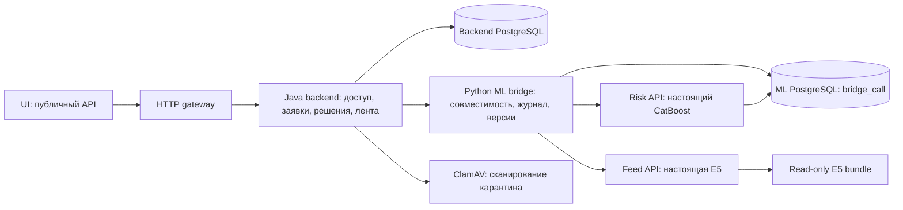

> Следующий срез UI/Feed/Fraud: `integration/ui-feed-antifraud-mvp`. Актуальные решения, подготовка, проверки и ограничения: [runbook](ui-feed-antifraud-runbook.md), [таблица решений](ui-feed-antifraud-decisions.md). Ниже сохранено описание проверенной исходной интеграции; её Linux PASS относится к 5b937b5, а не автоматически к новой ветке.

# Backend + ML: интеграционный MVP

Актуальность: 22 октября 2026. Этот документ описывает фактическую интеграционную поставку. Комплект HACKATHON-1.5 сохранён как исходная спецификация более широкого продукта; его исторические PDF и PASS не являются доказательством запуска этой версии.

## Состав и источники

База ML: `integration/ml-audit-20261021`, commit `af86831`. Backend: `backend/p15-ml-rfi-decisions`, commit `4f229b0`, включает P03/P05/P08/P25/P10. Полные SHA и состав веток - `reports/integration-20261022/source-versions.json`. Рабочая ветка: `integration/backend-ml-mvp`. Исходные рабочие папки пользователя не изменялись; интеграция создана в отдельном checkout.

Risk: неизменённый обученный CatBoost baseline `ml/artifacts/baseline`, восемь финансовых коэффициентов, `BANKRUPTCY_PROXY / DEMONSTRATION / DEMO_RESEARCH`. Feed: локальная E5 CPU и каталог v1 из 36 карточек. Числа и исходы скоринга синтетические; score не является банковской PD.

Более свежие ветки `802f998` (антифрод) и `87af049` (E5+CatBoost, новый каталог) изучены отдельно. Они не активируются в этой интеграции автоматически. Антифроду нужен доверенный независимый reference, которого текущий backend не предоставляет; подмена его заявленными финансами недопустима. Новый рекомендатель требует отдельного модельного релиза и оценки каталога, данных и качества. Код и evidence этих веток остаются сохранёнными в Git. См. аудит и backlog.

## Архитектура и владельцы



Backend владеет сессиями, контекстом компании, подтверждением финансов, неизменяемыми финансовыми снимками, RFI, решениями, предложениями, предпочтениями, выдачами и реакциями. ML не создаёт пользователей, не выдаёт права и не принимает кредитных решений. Backend и ML используют отдельные БД; ни один сервис не читает таблицы другого владельца напрямую.

В Compose опубликован только HTTP gateway на `127.0.0.1:8080`. Backend, Risk, Feed, bridge, обе БД и ClamAV находятся в сети `internal: true`. Nginx соединяет ingress с внутренним backend; он не принимает решений и не хранит сессии. Это необходимо: публикация порта контейнера только во внутренней Docker-сети не обеспечила доступ с Linux host в первой проверке. Интернет доступен сетевому ingress, но изолированным ML-процессам и БД исходящий доступ не предоставлен. Установка зависимостей и подготовка весов происходят до запуска изолированного runtime. Образы пока закреплены тегами; digest образов сохраняется в evidence Linux-прогона. Это не обещание воспроизводимости старого образа по изменяемому тегу.

## Совместимость Risk

Backend продолжает использовать `ML_BASE_URL`, `X-Service-Token` и свои DTO. ML bridge переводит авторизацию в Bearer для Risk и направляет запросы в отдельные сервисы. Исходный native Risk API сохранён.

1. Backend передаёт точный `financialSnapshotId`, digest, версию и время создания неизменяемого снимка. Оно служит временем доступности подтверждённых входов и стабильным asOf попытки; это не утверждение о времени публикации внешней отчётности.
2. Bridge проверяет backend digest по сериализации P15: statementVersion, порядок LinkedHashMap, восемь значений и полные documentId/documentVersion/objectVersion. Денежные значения не округляются, не восстанавливаются и не исправляются.
3. Для native ML вычисляется отдельный canonical digest. Обе ссылки и преобразование сохраняются в журнале. Ответ backend содержит его исходную финансовую ссылку и отдельный проверяемый digest представления признаков.
4. Специальный ML input profile поддерживает годовую DEMO-форму и допуск баланса backend: max(100 копеек, 1% активов с HALF_UP). Все восемь коэффициентов рассчитываются по исходным значениям; эквивалентность legacy transform проверена. Документы сохраняются в provenance, их текст не входит в модель. Native legacy профиль остаётся строгим и побайтно сохраняет исходный `features.py`.
5. Журнал `ml.bridge_call` фиксирует input hash, bundleDigest, featureCodeDigest и inputAdapterDigest до обращения к Risk. Повторы сериализуются блокировкой PostgreSQL, конфликт входа даёт 409. Успешный результат возвращается только после commit; после отказа сохранения native идемпотентность позволяет безопасно повторить операцию.
6. RFI использует новый финансовый снимок. Идентичность нового ML-профиля связана с финансовым снимком, поэтому исходный submission не блокирует обработку исправленной формы.

Risk использует исходную модель и служит единственным местом inference. Bridge не загружает CatBoost и не считает score. Изменение релиза не подменяет закреплённую модель незавершённой попытки; при недоступности закреплённого bundle возникает конфликт, backend отправляет дело на MANUAL. Для восстановления нужно вернуть прежний bundle или начать отдельную явную попытку рассмотрения, а не переписывать журнал.

## Политика решений

Авторитет - Java `DemoPolicyV1`, версия `demo-policy-v1`. Порядок: неполные данные/противоречие выручки (>50%) - RFI; возраст бизнеса; нулевая выручка - MANUAL; отрицательный капитал или liabilities/assets >=0.9 - DECLINED; сбой Risk - MANUAL; лимит 25% выручки - ALTERNATIVE либо DECLINED ниже минимума; score >=0.5 - MANUAL; иначе APPROVED.

Порог 0.5 сохранён из backend для совместимости demo-policy. Он не равен историческому T_manual=0.03504223273828764 из исследовательской ML-policy и не сохраняет её долю ручной проверки. В MVP нет банковского обоснования ни одному из порогов. Это явное архитектурное решение для демонстрации, не калибровка и не перенос кредитной методологии.

`ml/bridge/backend_policy.py` - только приёмочный Python-эталон Java-policy. Старые `scoring/demo_policy.py`, S01-S06 и отчёты обучения остаются историческими сценариями своего профиля, а не источником решений интеграционного приложения. Контрактные двойники доступны для unit-тестов, но Compose принудительно включает `ML_MODE=http`.

## Рекомендательная лента

Публичные endpoints: GET/PUT `/api/v1/feed/preferences?companyId=...`, GET `/api/v1/feed`, GET `/api/v1/feed/saved`, POST `/api/v1/recommendation-feedback`. Обязательны cookie, выбранная компания и X-Company-Context; мутации защищены CSRF. Состояние принадлежит `(actor, company)`.

Backend фиксирует выдачу и исключает скрытые, подтверждённые VIEW и уже выданные в текущей подборке карточки. Cursor - случайный серверный идентификатор, связанный с пользователем, компанией, каталогом и версией предпочтений; повтор возвращает сохранённую порцию/exposure без нового ранжирования. Допускаются только исключение текущих скрытых карточек и обновление userReaction. Смена предпочтений инвалидирует старые cursor. Сохранённое полезное имеет отдельную savedVersion и не фильтруется обычными VIEW/issued.

Bridge принимает современный Feed DTO на `/internal/v2/feed/rankings`; старый RankingGateway поддержан отдельно на `/internal/v2/rankings` с переводом digest и allowlist enum-контекста. Свободный contextText в модель не передаётся. Источник applicationStage без явно выбранной заявки отсутствует и не выдумывается. PRODUCT-ранжирование моделью не объявляется реализованным: доступность продуктов определяет backend.

При отказе Feed модель заменяется существующими Python RulesRanker. Если недоступен весь bridge, backend использует эквивалентные Java-правила; порядок проверяется общими golden fixtures. Ошибки авторизации, каталога, DTO и некорректная перестановка не маскируются успехом. MODEL/RULES и releaseId видны в metadata.

Последняя серверно принятая HELPFUL/NOT_INTERESTED заменяет прежнюю реакцию; occurredAt не определяет приоритет. clientEventId и обязательный HTTP Idempotency-Key долговечны; миграция V15 закрепляет один ключ за событием и проверяет неизменность тела и ключа. Карточка должна присутствовать в выданном этому actor/company exposure. Выдача не создаёт VIEW: UI отправляет его после >=50% видимости в течение >=1000 мс; backend не может измерить реальную видимость браузера.

## Минимальные изменения backend и их причины

- Передача createdAt финансового снимка: только backend знает достоверное время доступности подтверждённого входа. ML не может его придумать.
- Новый workspace Feed-срез и миграция V14: cookie/права, предпочтения, cursor, выдачи и реакции требуют backend-транзакций. Хранение этого в ML нарушило бы границы владельцев.
- Клиент современного Feed DTO и Java RulesRanker: публичная лента отсутствовала; сохранность выдачи и fallback при отказе всего ML-контура должны обеспечиваться backend.
- Изменения state machine заявок, решений, оферт и основной Java-policy не вводились. Остальные расхождения исправлены на стороне ML.

## Запуск Docker Compose на Linux

1. `python3 scripts/integration/configure.py` создаёт приватный .env с новыми случайными значениями и не перезаписывает существующий.
2. `docker compose config --quiet` и `docker compose build`.
3. `mkdir -p .local/feed-bundle`.
4. На целевом Linux подготовить E5 с разрешённой сетью:

```sh
docker run --rm --user "$(id -u):$(id -g)" -e HOME=/tmp \
  -e HF_HUB_OFFLINE=0 -e TRANSFORMERS_OFFLINE=0 \
  -v "$PWD/.local/feed-bundle:/bundle" --entrypoint python \
  credit-mvp-feed:local -m feed.prepare --bundle /bundle --download
```

5. `docker compose up -d --wait --wait-timeout 300`.
6. Установить jsonschema в отдельную Python-среду и запустить `python scripts/integration/smoke.py --output reports/integration-linux/smoke.json`.

Веса не лежат в Git. Подготовка закрепляет revision, SHA и библиотеки целевой среды. Mac bundle нельзя объявлять Linux bundle без пересборки manifest/проверки зависимостей. CPU-wheel PyTorch использует свою строку версии, отражённую в подготовленном manifest. ClamAV использует образ с предзагруженными сигнатурами и отключённым freshclam; обновление сигнатур - отдельная подготовка. См. [официальную документацию ClamAV](https://docs.clamav.net/manual/Installing/Docker.html).

Для повторного автономного развёртывания нужны сохранённые образы (`docker save/load`), весь feed-bundle, .env и volumes. Первая установка требует сеть. Не выполнять `down -v` для обычного перезапуска или отката.

## Проверка, выпуск и откат

Реальные проверки и точные ограничения находятся в `reports/integration-20261022/`. Linux Compose проверяется отдельным workflow `.github/workflows/integrated-mvp.yml`: чистая сборка, модельная подготовка, public HTTP/OpenAPI, restart, отказ Feed, отказ Risk и отсутствие внешнего TCP. Отсутствие успешного run означает NOT_VERIFIED_LINUX, независимо от локальных PASS.

Подробный аудит: `docs/integration-audit.md`. Регистрация источников, wire API bridge, public OpenAPI и новый архитектурный guide являются источниками поставки. `scripts/integration/contracts.py` пересобирает runtime-схемы и копию каталога backend; `scripts/integration/build_docs.py` пересобирает PDF, диаграмму и контрольные суммы интеграционных документов.

Откат: сохранить .env, feed-bundle и резервные копии обеих БД; вернуть прежние проверенные образы и модельный bundle. V14-V16 аддитивны; таблицы и события не удаляются при откате. V16 подставляет прежний eventId как command key для старого backend, который ещё не передаёт новую колонку; новые запросы используют явно закреплённый HTTP key. Старую ML-поставку запускать на отдельном профиле; не направлять новые backend-запросы на прежний несовместимый API. После смены bundle незавершённые попытки завершаются старым релизом либо явно передаются на MANUAL. Native-откат на backend 8f9b7b1 поверх обновлённой БД и возврат к новой сборке проверяются отдельными rollback HTTP-отчётами; данные и события сохраняются.

## Границы готовности

Публичный UI из соседнего проекта пока использует provisional-v1; для фактического backend поставлен отдельный типизированный adapter `frontend/integration/api.ts`. Полный UI ещё не принят. Антифрод, новый CatBoost-рекомендатель, OCR-worker, ассистент, принятие оферты и банковское оформление не объявляются частью проверенного сквозного сценария. Существующие upload/quarantine/AV и точные версии документов сохранены; в native HTTP-проверке путь ручного ввода не требует документов. Отказ сканера не даёт CLEAN.

Для банковского пилота нужны реальные зрелые labels, независимая валидация, согласованная policy, эксплуатационные SLO, управление секретами и инфраструктурная приёмка. Синтетические проверки подтверждают реализацию и сценарии, а не кредитное качество.
