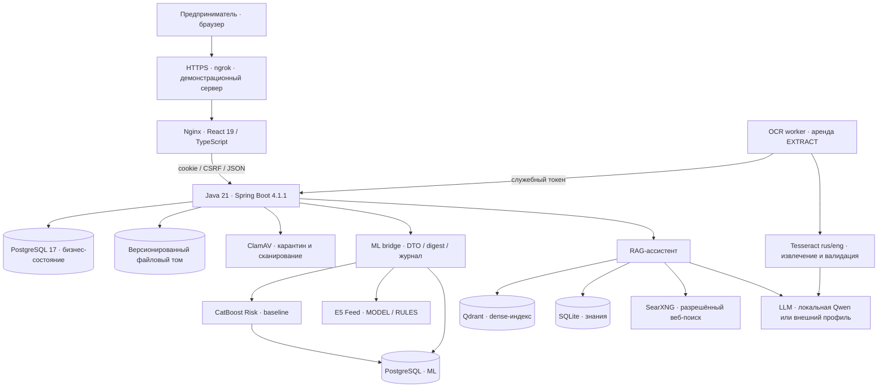
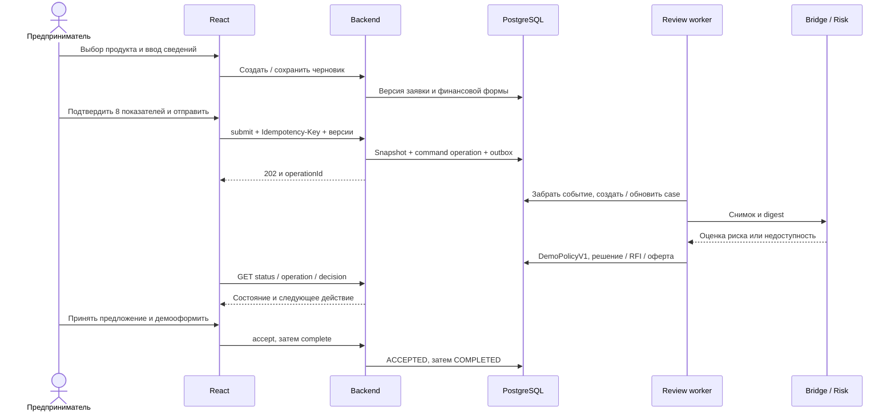
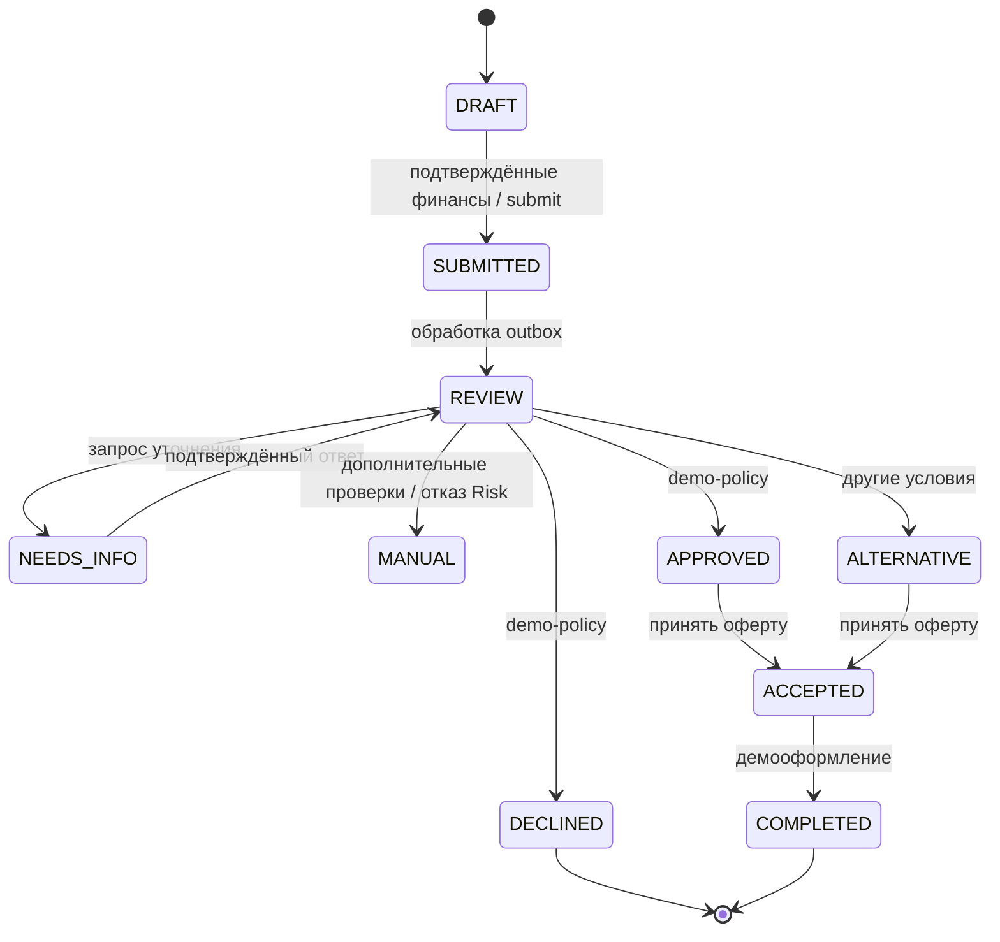

# Архитектура работающего MVP

## Назначение и границы

«Поток» объединяет клиентский путь малого бизнеса и демонстрационное кредитное рассмотрение: потребность, выбор продукта, сведения о компании, документы и финансовые показатели, подача, решение или уточнение, предложение, принятие и демооформление. Пользователь остаётся внутри веб-кабинета. SMS, почта и корпоративные системы банка для основного сценария не нужны.

Backend — модульный монолит с общей транзакционной базой. Ресурсоёмкие Risk, Feed, OCR и ассистент работают отдельными Python-процессами. Это сохраняет понятную транзакционную границу бизнеса и позволяет независимо развивать AI-модули.

## Компоненты и взаимодействие

Схема показывает связи реализации. Конкретный режим LLM на опубликованном сервере нельзя определить по одному URL. Репозиторий поддерживает внешний профиль и полностью локальный профиль Qwen. Подтверждённый публичный доступ приведён в [отчёте](evidence/live-readonly.json); Docker-топология задаётся [compose.yaml](../../compose.yaml), локальная LLM — [overlay](../../deploy/compose.local-llm.yaml).

| Компонент | Ответственность и данные | Статус / доказательство |
|---|---|---|
| gateway | Собранный React, `/api/` к backend, единственная локальная публикация `127.0.0.1:8080` | Реализовано; production UI без MSW |
| backend | Сессии, компании, каталог, заявки, финансовые формы, документы, рассмотрение, оферты, лента, прокси ассистента | Реализовано; backend-тесты и сквозная приёмка |
| backend-db | PostgreSQL 17, Flyway V1–V20, бизнес-данные, сессии, outbox/inbox | Реализовано; две разные БД для business и ML |
| risk | CatBoost baseline; immutable bundle с manifest и SHA256 | Реальный inference; оценки качества получены на синтетике |
| feed / feed-init | Локальные E5 embeddings, ранжирование ленты, подготовка bundle | Стабильный default v1, E5 |
| ml-bridge | Согласование DTO backend/ML, digest, долговечная идемпотентность вызовов | Реализовано; сам не пересчитывает risk |
| ml-db / ml-migrate | Снимки признаков, inference и bridge-call journal; миграции V1–V3 | Реализовано; миграции до старта Risk |
| scanner | ClamAV, файл доступен для чтения только после CLEAN | Реальный движок; обновление сигнатур требует обслуживания образа |
| ocr | Tesseract, LLM-кандидаты, JSON Schema и проверки цитат | Реализовано; отдельная проверка настоящего Tesseract + Qwen |
| ocr-worker | Аренды backend, точная CLEAN-версия, журнал сопоставления задач SQLite | Реализовано; heartbeat подтверждает worker, но не качество extraction |
| assistant / assistant-init | E5 + BM25 + RRF, контекст компании, инструменты чтения, проверка источников | Реализовано; реальная локальная генерация проверялась отдельно |
| qdrant | Производный dense-индекс знаний | Настоящий сервис в Compose |
| searxng | Поиск по разрешённым доменам, доступность зависит от внешней сети | Реализовано; внешний поиск не является автономной локальной функцией |
| ollama / ollama-init | Qwen2.5 3B в профиле `local`, одна общая модель для OCR/RAG | Реализована конфигурация; ёмкость всей CPU-сборки на 16 GB не подтверждена |
| Feed v2 / CatBoost ranker | Расширенный каталог, выбор версии, откат | Экспериментально; promotion gates не объявляются пройденными |
| Synthetic antifraud | Proxy искусственных манипуляций, `FRAUD_MODE=synthetic` | Экспериментально, выключен по умолчанию |

## Модули backend

| Модуль | Что делает |
|---|---|
| access | PBKDF2-SHA256 credentials, сессия, выбор компании, membership и tenant isolation |
| catalog | Версионированные продукты, требования к документам, ограничения суммы и срока |
| applications | Черновики, конкурентное редактирование, подтверждённые финансовые формы и immutable snapshots |
| documents | Upload/download grants, карантин, версии файлов, фоновые SCAN/EXTRACT jobs, extraction |
| journey | Command operations, outbox, запросы дополнительной информации |
| integration | Bank case, inbox, фоновое рассмотрение, Java DemoPolicyV1, решения и оферты |
| workspace | StatusView, история/следующее действие, предпочтения и реакции ленты |
| ml | HTTP gateways, snapshot/inference records, версии входов и результатов |
| assistant | Авторизованный proxy, trusted bank context, привязка диалога к компании и browser session |
| platform / ports / adapters | Общие ошибки, ETag, деньги, границы хранилищ и инфраструктурные реализации |

`consents` и `kb` представлены пакетными архитектурными границами. Отдельного полноценного клиентского consent API и банковской системы знаний это не доказывает. Redis/Kafka/S3 adapters сохранены, но их подключение в базовом Compose отсутствует.

## Сквозное рассмотрение

Скоринг отделён от решения. `DemoPolicyV1` сначала проверяет полноту финансов, расхождение выручки и eligibility. Нулевая выручка ведёт к MANUAL, отрицательный капитал или liabilities/assets ≥ 0,9 — к DECLINED. Сбой Risk ведёт к MANUAL. Сумма выше `min(product.max, 25% выручки)` может привести к ALTERNATIVE. После этих проверок risk score ≥ 0,5 ведёт к MANUAL, иначе — APPROVED. Эти пороги искусственные и не являются политикой Альфа-Банка.

Это диаграмма реализованного пути: backend хранит отдельно статус черновика/подачи и статус bank case, а UI получает их через StatusView. В enum также зарезервированы CANCELLED и EXPIRED; наличие enum не означает реализованный полный пользовательский путь отмены или истечения. Для MANUAL не нарисовано фиктивное продолжение оператором.

## Документы и OCR

Создание upload-intent проверяет компанию и требования. Файл передаётся потоком с grant в заголовке, типами PDF/JPEG/PNG и пределом 10 MiB. После карантина настоящий ClamAV допускает CLEAN-объект. OCR worker арендует EXTRACT job, продлевает lease и читает только указанную версию. Tesseract извлекает текст, LLM формирует поля, сервер проверяет схему и источники. Результат относится к конкретным objectVersion/extractionId/generation.

OCR не меняет финансовую форму молча. Пользователь выбирает найденные показатели, проверяет период/единицы, дополняет пропуски и подтверждает значения. Несколько документов дополняют анкету. `total_debt` нельзя автоматически считать `totalLiabilities`. После аварии между submit OCR и записью журнала возможен повтор генерации; exactly-once вызов модели не обещается.

## Ассистент и лента

Backend передаёт ассистенту идентичность и read-only контекст текущей компании на каждый ход. Browser не выбирает себе чужую identity и не получает service token. Модель не меняет заявку. Источники и права проверяются сервисом; синтетические документы стартового корпуса исключены из пользовательских ответов. При недоступной генерации возможен SEARCH_ONLY с реально найденными источниками. Это не считается успешным LLM-ответом. История диалогов временная; знания и производный индекс сохраняются.

Лента учитывает контекст компании и предпочтения. Backend хранит выборку, cursor, exposure и feedback, обеспечивая повторяемость страницы и повторную отправку реакций. При сбое Feed используются правила RULES. Закреплённое обязательное действие по заявке не должно исчезать из-за ранжирования контента.

## Надёжность и безопасность

- Доступ по серверной сессии, HttpOnly cookie, CSRF для изменяющих операций, Origin-проверка входа, company membership и версии контекста. Secure cookie зависит от профиля HTTPS.
- If-Match/ETag защищает от потерянных обновлений. Снимки подачи неизменяемы. Финансовые суммы хранятся целыми копейками, NULL отличается от нуля.
- PostgreSQL outbox/inbox и command journal связывают шаги без необходимости Kafka в MVP. Фоновые работы используют аренды и поколения.
- Внутренние токены, ML/БД и admin API не публикуются gateway. Сети Compose разделяют ingress, internal и outbound. Внешняя LLM получает только то, что допускает выбранная конфигурация.
- Данные сохраняются в named volumes. Обычный `down` их сохраняет, `down -v` удаляет. Односерверная схема остаётся единой точкой отказа.
- Два общих демологина не получают 15-минутную блокировку. Для остальных credentials политика сохранена. Gateway ограничивает частоту входа и возвращает 429/Retry-After.
- Публичные кабинеты предназначены только для синтетической демонстрации. Публикация их паролей согласована владельцем; служебные секреты к ним не относятся.

## Ограничения и развитие

БКИ, ФНС/KYC/AML, АБС, ЭП, денежная выдача, корпоративный SSO, рабочее место андеррайтера, промышленный мониторинг и высокая доступность не подключены. Синтетическая оценка моделей не доказывает качество на реальном МСБ. Путь внедрения описан в [bank-roadmap.md](bank-roadmap.md).
