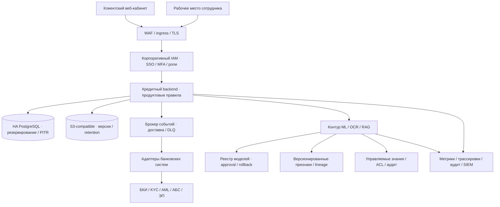

# Развитие MVP для банковского внедрения

Это целевая архитектура, а не перечень подключённых сервисов. Основа — прежняя [архитектурная поставка](../architecture/README.md), уточнённая по фактическому MVP. Технология добавляется под измеренную потребность, с владельцем данных и проверкой отказа/отката.

## Разрыв между MVP и банковским контуром

| Сейчас | Что внедрить | Зачем | Как принять |
|---|---|---|---|
| Два demo-логина, membership и cookie-сессии | Корпоративный OIDC/SAML, MFA, роли представителя/оператора/андеррайтера, делегирование полномочий | Управление доступом и жизненным циклом сотрудников/представителей | Матрица ролей, отзыв доступа в активной сессии, аудит действий, cross-tenant тесты |
| MANUAL без операторского завершения | Очередь дел, карточка сотрудника, reason codes, контролируемое ручное решение | Завершение нестандартных кейсов | Сквозной MANUAL → решение, разграничение полномочий, двойное согласование критичных действий |
| Java DemoPolicyV1 с искусственными порогами | Версионированные банковские продуктовые правила и approval | Согласованная кредитная политика | Контрольный набор кейсов, объяснения результата, replay и согласованный rollback |
| Синтетический CatBoost BANKRUPTCY_PROXY | Обучение и валидация на разрешённых реальных данных, калибровка, временные выборки | Доказать применимость оценки риска | Out-of-time оценка, discrimination/calibration, стабильность, независимая модельная валидация |
| Экспериментальный synthetic antifraud | Источники подтверждённых сигналов, fraud-политика и аналитическое расследование | Проверки без объявления синтетической аномалии мошенничеством | Качество на размеченных кейсах, false positives, эскалация, журнал причин |
| БКИ/KYC/AML/ФНС/АБС отсутствуют | Адаптеры с согласованными контрактами, SLA, согласием и идентификаторами запросов | Использование доверенных банковских данных | Sandbox каждого провайдера, timeout/retry/circuit breaker, replay, сверка данных |
| Демооформление без денежных операций | ЭП/договоры/выдача в АБС, сверка и компенсационные процедуры | Юридически и операционно завершённый процесс | Идемпотентность, потерянный ответ, reconciliation, журнал согласий и подписей |
| Одна PostgreSQL на business и одна на ML | HA, PITR, управление схемами и нагрузкой | Восстановление и доступность | Согласованные RPO/RTO, учение восстановления, отказ узла, проверка резервных копий |
| Версионированный локальный файловый том | Настоящий S3 adapter, lifecycle, encryption, retention | Масштабирование документов и управление хранением | Совместимые grants/версии, quarantine, запрет чтения нечистого объекта, restore |
| PostgreSQL outbox/inbox | При необходимости Kafka/другой банковский брокер через порты, DLQ и replay | Разделение потребителей и масштабирование доставки | At-least-once без второго бизнес-эффекта, порядок событий, отказ брокера и откат |
| JDBC sessions и локальный bounded cache | При измеренной необходимости Redis для cache/session с явной authority | Снижение нагрузки и горизонтальные экземпляры | Miss/eviction/outage, отзыв сессии, отсутствие потери авторитетных данных |
| Снимки признаков и manifests | Реестр моделей, approval, quality gates, lineage; Feast/MLflow по потребности | Воспроизводимость обучения и controlled release | Train/serve parity, версии/хеши, воспроизводимый replay, откат модели вместе с совместимым кодом |
| Скрипты подготовки и ручной запуск | CI/CD, registry, сканирование образов, управляемый rollout | Повторяемая поставка и снижение ошибок обновления | Чистая сборка по tag, staging E2E, rollback drill, проверка миграций |
| Логи и healthchecks | Prometheus/Grafana или банковский стек, tracing, бизнес-метрики, SIEM | Диагностика пути заявки и инцидентов | Корреляция request/job/case, искусственный сбой, alert с владельцем и runbook |
| Стартовый публичный корпус и source validation | Управляемая KB с ACL, лицензиями, версиями, отзывом и регламентом публикации | Надёжные ответы и разделение доступа | Отзыв документа из поиска/истории, prompt injection tests, аудит источников |
| Один CPU-LLM и последовательные запросы | Измерение очереди, лимиты, масштабирование inference, при необходимости GPU | Предсказуемое ожидание чата и OCR | Нагрузочный профиль, p95, memory/OOM, starvation, отказ модели |
| 2 синтетические компании | Pilot, продуктовая аналитика, usability и доступность | Подтверждение полезности | Согласованные задачи пользователей, completion/drop-off, ошибки, качественные интервью |

## Конкретные кандидаты технологий

Это предлагаемые замены и усиления, **не текущие подключения**. Выбор утверждается банком после оценки совместимости, лицензий, качества и нагрузки.

| Слой | MVP | Предлагаемое изменение | Проверка результата |
|---|---|---|---|
| LLM | Qwen2.5 3B / Ollama, последовательные CPU-запросы | **Qwen3-32B через vLLM на GPU** как кандидат с Apache 2.0 | Сравнить groundedness, корректность цитат, OCR JSON, p95 и стоимость на банковской выборке. Больший размер сам по себе не доказывает качество |
| БД | Одиночный PostgreSQL | **PostgreSQL + Patroni/etcd + pgBackRest**, реплики и PITR | Failover, восстановление на заданный момент, согласованные RPO/RTO. Менять SQL-движок только ради банковского статуса не требуется |
| Периметр и сертификаты | Публичный HTTPS ngrok | **Домен банка, WAF, gateway/TLS, cert-manager с PKI банка**, mTLS внутренних вызовов по модели угроз | Доверенная цепочка, продление и отзыв сертификатов, проверка защищённых границ. HTTPS уже присутствует на демо |
| Авторизация | Два demo-логина | **Keycloak/OIDC, MFA и RBAC** либо действующий корпоративный IAM | Отзыв доступа, матрица ролей, аудит и изоляция компаний |
| Секреты | Локальный .env | **OpenBao** или банковский secrets manager/KMS | Ротация, short-lived credentials и проверяемый аудит без утечек в логи |
| Документы | Версионированный файловый том | **Ceph S3**, при Kubernetes возможно Rook | Объектные версии, retention, quarantine, восстановление и контроль доступа |
| События | PostgreSQL outbox/inbox | **Kafka**, сохраняя транзакционный outbox | Повторная доставка, DLQ/replay и отсутствие второго бизнес-эффекта |
| Эксплуатация | Docker Compose / healthchecks | **Kubernetes**, **Prometheus/Grafana**, OpenTelemetry и банковский SIEM | Нагрузочный профиль, rolling update, rollback, трассировка заявки и учения отказа |

Официальные технические источники, проверены 26.10.2026: [Qwen3-32B](https://huggingface.co/Qwen/Qwen3-32B), [Patroni](https://patroni.readthedocs.io/en/latest/), [pgBackRest](https://pgbackrest.org/), [cert-manager CA issuer](https://cert-manager.io/docs/configuration/ca/), [Keycloak](https://www.keycloak.org/), [OpenBao](https://openbao.org/), [Rook/Ceph](https://rook.io/).

## Последовательность внедрения

1. **Пилот в тестовом контуре:** IAM, роли, секреты, управляемая конфигурация, согласованные данные, мониторинг и восстановление. Зафиксировать SLA и владельцев.
2. **Завершение банковского процесса:** рабочее место сотрудника, реальные проверки, версия политики, договоры и тестовый контур выдачи.
3. **Валидация ML и знаний:** разрешённые данные, lineage, независимая оценка, качество OCR/RAG и контроль публикации корпуса. Эксперименты не включать автоматически.
4. **Масштабирование по измерениям:** HA, файловое хранилище, очередь и inference capacity. Kubernetes, Kafka, Redis, Feast и Airflow не являются обязательным первым шагом.

Сроки и стоимость требуют команды банка, интеграционных контрактов и результатов нагрузочных испытаний. Часы из ранней хакатонной спецификации не используются как оценка промышленного внедрения.
