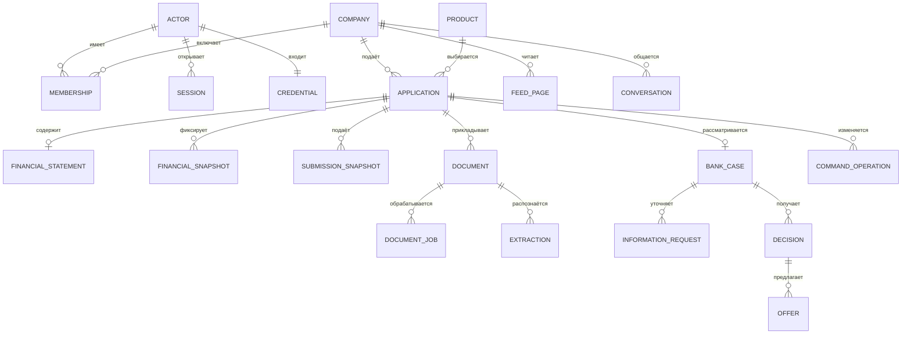

# Модель данных

Источники: Flyway [backend migrations](../../backend/app/src/main/resources/db/migration/) V1–V20, [ML migrations](../../ml/migrations/) V1–V3 и Alembic [assistant](../../ml/assistant/migrations/). Схема описывает физические таблицы и логические связи. Не каждая стрелка является SQL FOREIGN KEY: часть границ модулей связывается по идентификаторам и проверяется application services.

## Владение данными

| Схема / таблицы | Назначение и ключевые ограничения |
|---|---|
| `access.actor`, `company`, `company_membership` | Пользователи, синтетические компании и полномочия. Actor не получает доступ к компании только из-за знания её ID |
| `access.credential` | Логин, соль и PBKDF2-SHA256 hash, не открытый пароль; связь с actor; учёт неудачных входов и locked_until для non-demo; legacy-блокировка двух общих demo игнорируется и очищается при успешном входе |
| `access.session` | Хеш сессионного токена, actor, выбранная компания, срок, CSRF и версия контекста |
| `catalog.product`, `document_requirement` | Версии продуктов и требований. Заявка и документы связываются с конкретными версиями |
| `applications.application` | Версия, статус подачи, выбранный продукт, сумма/срок/цель и business-поля черновика |
| `applications.submission_snapshot` | Неизменяемый снимок отправленных данных, версия заявки, документы и финансовый snapshot |
| `applications.financial_statement` | Текущие восемь показателей, отчётный период, стандарт DEMO, валюта RUB, confirmed и версия |
| `applications.financial_provenance` | На каждое подтверждённое поле: источник MANUAL/OCR, кто/когда подтвердил, extractionId/objectVersion для OCR |
| `applications.financial_snapshot` | Immutable JSON значений и provenance, companyId, statementVersion и digest. Триггер запрещает UPDATE/DELETE |
| `applications.request_key` | Идемпотентность PUT/confirm по actor/company/scope/key и digest тела |
| `applications.information_draft` | Версионированный черновик ответа на уточнение, отдельный финансовый контейнер |
| `journey.command_operation`, `outbox` | Принятая команда и результат; транзакционно записанное событие для фоновой доставки |
| `journey.information_request` | Версия RFI, требуемые поля/документы, срок и состояние запроса |
| `integration.inbox`, `bank_case` | Дедупликация событий и банковское состояние процесса, отдельное от черновика заявки |
| `integration.review_task` | Очередь фонового рассмотрения с арендой и повторами |
| `integration.decision`, `offer`, `offer_command` | Сохранённые решения и предложения, срок/версия/статус, идемпотентные accept/complete |
| `integration.synthetic_reference`, `fraud_attempt`, `fraud_result` | Исследовательский antifraud: reference, попытка проверки и результат; отдельная экспериментальная функция |
| `documents.document` | Владелец, applicationId, версия документа, objectVersion, scan/extraction state, размер и тип |
| `documents.upload`, `download_grant` | Ограниченные по сроку файловые разрешения; grants не передаются в query string |
| `documents.document_job` | Тип SCAN/EXTRACT, lease, worker, generation и статус; устаревший результат не применяется |
| `documents.extraction` | Извлечённые кандидаты полей с источником/страницей и версией движка |
| `workspace.feed_state`, `feed_selection`, `feed_page` | Предпочтения/контекст, стабильная выборка, cursor и exposures |
| `workspace.feed_event`, `feed_reaction` | Идемпотентные события взаимодействия и текущие реакции |
| `assistant.conversation` | Серверное сопоставление browser session + company + имя диалога с remote session/token. Токен остаётся на backend |
| `ml.inference_record` в business DB | Бизнес-привязка inference к snapshot и версии входа |
| `ml.features`, `inferences`, `bridge_call` в ML DB | Материализованные признаки, результаты и журнал HTTP-согласования. Другая физическая PostgreSQL |
| `ml.fraud_features`, `fraud_inferences` в ML DB | Синтетический дополнительный inference, не заменяющий credit risk |

Полный автоматически извлечённый список физических таблиц и исходных миграций: [schema-inventory.md](schema-inventory.md). Там сохраняются первоначальные CREATE TABLE; изменения колонок следует читать вместе с последующими миграциями.

## Финансовые показатели

Все суммы — целые копейки в RUB, абсолютное значение не выше безопасного целого JavaScript `9007199254740991`. Активы, обязательства и выручка неотрицательны; капитал, чистая прибыль и EBIT могут быть отрицательными. Пустое поле и ноль имеют разный смысл.

| JSON-поле | Значение |
|---|---|
| `totalAssetsMinor` | Все активы |
| `totalLiabilitiesMinor` | Все обязательства |
| `currentAssetsMinor` | Оборотные активы |
| `currentLiabilitiesMinor` | Краткосрочные обязательства |
| `equityMinor` | Собственный капитал |
| `revenueMinor` | Выручка за период |
| `netProfitMinor` | Чистая прибыль |
| `ebitMinor` | Прибыль до процентов и налогов |

UI отображает рубли и разделители разрядов; API получает копейки. Перед submit подтверждаются все восемь показателей. Подтверждение версии не должно ссылаться на другой objectVersion документа. Immutable snapshot фиксирует именно рассмотренные данные, поэтому изменение черновика не изменяет уже вынесенное решение.

## Остальные хранилища

- **Файловый том `objects`:** исходные/чистые версии документов. Метаданные и права остаются в PostgreSQL. Это не S3.
- **SQLite ассистента:** корпус и версии знаний, публикация и атрибуция. Qdrant — производный индекс, а не единственный источник знаний.
- **SQLite OCR и worker:** долговечные задания и сопоставление OCR job с backend job. Время хранения OCR jobs — 24 часа.
- **Модельные volumes:** закреплённые E5 bundles, tokenizer и подготовленные модели. Подготовка при первом запуске не является переобучением.
- **Память ассистента:** временная история сессии, не гарантированная долговременная банковская переписка.

## Миграции, перенос и восстановление

Backend применяет Flyway при старте, ML — отдельным `ml-migrate`, assistant — Alembic. Применённые SQL не редактируются: исправление оформляется новой миграцией. ML migration runner проверяет checksum. Для Windows нормализуются окончания строк, содержательные отличия миграций не скрываются.

Резервная копия должна согласованно включать обе PostgreSQL, документы, знания/индекс, журналы OCR и model volumes. Дамп одной business DB не восстанавливает весь продукт. Возврат версии приложения не должен удалять аддитивные таблицы. Процедура и ограничения: [эксплуатация](deployment.md).
