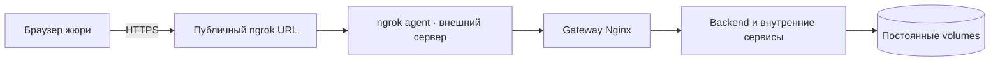

# Запуск и эксплуатация

## Быстрый старт проверяемой версии

Требуются Git, Docker Engine/Desktop с Linux containers, Compose v2.20+ и Python 3.10+. Node, Java и ML-библиотеки на хосте для Docker-запуска не нужны. Для Selectel overlay с `!reset` нужен Compose 2.24.4+. Пример ниже — Linux/macOS; в Windows используйте `python` вместо `python3`.

```sh
git clone https://github.com/Tonitrus1/ALFA-HACK-2026.git
cd ALFA-HACK-2026
git checkout submission-2026-10-26-r2
python3 scripts/deploy.py init
python3 scripts/deploy.py doctor
python3 scripts/deploy.py up --mode local
```

Открыть **http://127.0.0.1:8080**. `init` создаёт случайные локальные пароли в `.env` и `.local/cabinet-access.md`. Они отличаются от опубликованных паролей серверного демо. Повторный `init` сохраняет секреты. Не копируйте серверные пароли в новый локальный стенд без необходимости.

Первый запуск скачивает образы, пакеты и закреплённые AI-модели, поэтому требует интернета. E5/LLM затем используют сохранённые model volumes. Полная автономность веб-поиска не обещается: SearXNG обращается к внешним источникам.

## Профили

| Режим | Состав | Условия |
|---|---|---|
| `local` | Весь кабинет + Risk/Feed + ClamAV + OCR + RAG + Docker Ollama/Qwen2.5 3B | Открытые веса, без платного API. Для небольшой нагрузки планируется CPU 8 vCPU / 16 GB RAM / 160 GB SSD, но ёмкость всего стека на такой VM не подтверждена |
| `core` | Кабинет, БД, Risk, Feed, bridge, ClamAV | Основной путь с ручным вводом финансов. Ориентир от 8 GB Docker RAM и 30 GB свободного диска |
| `full` | Кабинет и AI-сервисы с внешним OpenAI-compatible endpoint | Дополнительный профиль: свой endpoint/key, стоимость и доступность зависят от провайдера. Для независимой бесплатной проверки выбран `local` |

```sh
# Облегчённое ядро
python3 scripts/deploy.py up --mode core
# Внешний профиль после настройки LLM в .env
python3 scripts/deploy.py up --mode full
```

Внешний `full` без ключа не подтверждает работу генерации: readiness AI возвращает 503. Смена профиля не является переносом данных в новую установку. Для существующего окружения сохраняйте прежние `--project`, `--context` и volumes.

## Конфигурация

Полный шаблон: [`.env.example`](../../.env.example). Скрипт [`deploy.py`](../../scripts/deploy.py) управляет init/doctor/build/up/status/logs/down. Описание всех параметров запуска: [`docs/deployment.md`](../deployment.md).

| Переменные | Назначение / правило |
|---|---|
| `COMPOSE_PROJECT_NAME` | Изоляция проекта и имена volumes. Не менять при обычном обновлении |
| `CABINET_A_PASSWORD`, `CABINET_B_PASSWORD` | Пароли двух синтетических компаний, локально генерируются автоматически |
| `BACKEND_DB_PASSWORD`, `ML_ADMIN_PASSWORD`, `ML_DB_PASSWORD` | Раздельные роли и секреты БД |
| `ML_SERVICE_TOKEN`, `ASSISTANT_SERVICE_TOKEN`, `OCR_API_KEY`, `DOCUMENT_OCR_TOKEN` | Внутренние границы сервисов; не публиковать и не передавать браузеру |
| `SEARXNG_SECRET` | Служебная настройка self-hosted поиска |
| `LOCAL_RAG_MODEL`, `LOCAL_OCR_MODEL` | По умолчанию `qwen2.5:3b`, общий Docker Ollama в режиме local |
| `LLM_BASE_URL`, `LLM_API_KEY`, `ASSISTANT_LLM_MODEL`, `OCR_LLM_MODEL` | Только внешний профиль. Наличие ключа не переключает local на платный API |
| `FEED_RELEASE`, `FEED_RANKER`, `FEED_BUNDLE_PATH` | Default v1/e5; v2 и catboost требуют подготовленного совместимого bundle |
| `FRAUD_MODE` | Default `off`; `synthetic` — явно включаемый исследовательский режим |
| `OCR_CPU_THREADS` | Ограничение CPU распознавания, default 2 |

Секреты не входят в Git. Одобренные публичные пароли демо перечислены отдельно в [`demo-access.json`](demo-access.json) и не являются service tokens.

## Ресурсы и ограничения локального LLM

В local overlay Ollama ограничена 6 CPU / 5 GiB RAM, одной загруженной моделью и одним одновременно выполняющимся запросом. RAG и OCR делят модель и могут ждать друг друга. Контекст 8192 токена; OCR использует строгую серверную проверку JSON Schema и цитат, лимиты ввода/вывода и тайм-аут до 300 секунд. Чат имеет согласованные тайм-ауты через backend/gateway/UI. Это функциональная конфигурация, не результат нагрузочного теста.

Подготовка моделей выполняется `feed-init`, `assistant-init`, `ollama-init`. При сетевом сбое повторите подготовку после восстановления сети; не отключайте checksum и не выдавайте неподготовленный bundle за рабочий.

## Стенд с ngrok и серверное развёртывание

Текущий демонстрационный URL: **https://president-diameter-endearing.ngrok-free.dev**. Владелец подтвердил запуск на внешнем сервере. HTTPS завершается на публичной стороне ngrok, затем туннель ведёт к приложению. Первый визит может показать страницу ngrok с кнопкой **Visit Site**.

По публичному URL подтверждены вход двух компаний, каталог, чтение заявок и изоляция. В свежей API-проверке лента обоих аккаунтов вернула `rankingMode=RULES` и `releaseId=feed-rules-v1`; успешный E5 inference на этом сервере этим не подтверждается. Ассистент при онлайн-проверке работал в `SEARCH_ONLY` с источниками; генерация была недоступна. Провайдер VM, аппаратные ресурсы, путь процесса туннеля и текущий режим LLM не заявляются как проверенные без доступа к серверной конфигурации. В репозитории также есть отдельный [Selectel runbook](../../deploy/selectel/README.md) с Caddy/TLS; наличие этого runbook не означает, что текущий ngrok-стенд использует Caddy.



Срок доступности демо зависит от работающего сервера и туннеля. Воспроизводимая версия хранится в Git и не зависит от сохранения этого URL.

## Проверки после запуска

```sh
docker compose ps -a
python3 scripts/integration/smoke.py --output reports/manual-smoke.json
python3 scripts/integration/local_llm_smoke.py
docker compose -f compose.yaml -f deploy/compose.local-llm.yaml exec -T ocr python scripts/verify_local_qwen.py
```

Последние две команды делают настоящие вызовы модели. В local-профиле проверка OCR использует синтетическое изображение, Tesseract, извлечение ИНН, сохранение ведущих нулей, source validation и обязательность подтверждения. Это не измерение качества на всех типах финансовых документов.

`smoke.py` создаёт синтетические заявки и реакции. Запускайте его на отдельном проверочном проекте, а не для безусловной очистки общего демо. Браузерные тесты: `npm --prefix frontend run test:e2e` после подготовки Playwright Chromium и корректного UI_BASE_URL.

## Остановка, обновление и восстановление

```sh
python3 scripts/deploy.py status
python3 scripts/deploy.py logs
python3 scripts/deploy.py down
```

Обычная остановка сохраняет volumes. **`docker compose down -v` удаляет данные и не используется для перезапуска.** Сохраняйте `.env`, дампы обеих БД, `objects`, assistant/ocr/worker/model volumes до обновления. В Selectel-поставке есть `scripts/selectel.py backup` и `restore` с cold backup; это процедура с остановкой, не непрерывное HA-резервирование.

Очистка демокомпаний — отдельный [`reset_cabinets.py`](../../scripts/reset_cabinets.py): она меняет данные и не выполняется при обычном старте или сдаче. Публичные кабинеты не очищаются автоматически.

| Симптом | Что проверить |
|---|---|
| Контейнер завершился с 137 | Docker RAM, OOM и параллелизм сборки/моделей |
| Не стартует Feed/assistant | `feed-init` / `assistant-init`, сеть, свободный диск, hash bundle |
| AI readiness 503 | Профиль, ключ внешнего API или доступность Ollama и подготовка модели |
| Не принимается вход | Логин/пароль именно этого стенда, Origin, HTTPS-профиль, версия backend, 429/Retry-After при слишком частых запросах |
| 409 при изменении | Перечитать сессию/ресурс, актуальные contextVersion/ETag; не повторять старое тело с новым ключом вслепую |
| OCR долго ждёт | CLEAN, lease/worker heartbeat, readiness OCR, общая очередь LLM |
| Лента RULES | Доступность Feed и подготовленного bundle; основной путь должен сохраняться |
| Risk недоступен | Ожидаемый безопасный исход MANUAL, а не автоматический отказ |

## Обновление работающего Docker-стенда

Точная последовательность Git и Docker: [update-runtime.md](../update-runtime.md). Обновляются backend и gateway; сохраняются исходные Compose-файлы, имя проекта, env-файл и volumes. Парольные ошибки больше не блокируют два демоаккаунта на 15 минут. Уже записанная блокировка перестаёт мешать после обновления backend.
