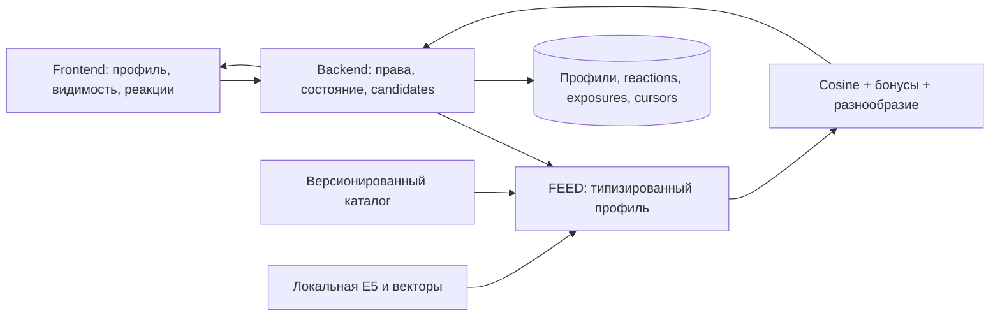

# Архитектура рекомендательной ленты

> Обновление 22.10.2026: каталог v2 на 72 карточки, синтетические события и экспериментальный CatBoost описаны в [текущей поставке](hackathon.md). Разделы ниже сохраняют описание E5 MVP и исторические проверки; новые результаты находятся в `reports/hackathon/`. [Контракт аналитического экспорта](analytics-contract.md).

Назначение: архитектура рекомендательной ленты.

Статус реализации: отдельный локальный ML-сервис; публичный backend и frontend не поставляются. Статус проверки документации — в [verification.md](verification.md).

Актуальность: 22.10.2026. Исходный проверяемый снимок: `ml/feed-recommendations` / [`829c1c09bb24`](https://github.com/Tonitrus1/ALFA-HACK-2026/commit/829c1c09bb248f03d730f25526de3b11712370bd). Среда исторических runtime-проверок: macOS arm64, Python 3.12.13. При этой миграции сервисы повторно не запускались.

## Компоненты и схема потока запроса

ML не хранит пользовательскую историю, не выбирает разрешённую компанию и не принимает решение по кредиту. Risk API не импортируется и не запускается лентой.

## Алгоритм обработки, правила и fallback

Enum-профиль преобразуется русскими шаблонами в `query: ...`. Passage — title + перевод строки + text карточки. E5 без дообучения: CPU float32, 384 измерения, 512 токенов, attention-mask mean pooling и L2. MODEL score = cosine + `0.05*clip(helpful-notInterested,-2,2)` + `0.03` за глубину. Затем ограничение: до двух карточек темы в каждой шестёрке, пока доступны другие темы; tie-break по ID. Это порядок, а не вероятность полезности.

При timeout/недоступности ML backend запускает `RulesRanker` с тем же закреплённым каталогом, профилем и агрегатами. Пример клиента использует timeout 1,8 с на сетевую операцию; общий бюджет публичного запроса backend должен ограничивать сам, без длинной цепочки повторов. 403/409/422 не маскируются под успех: это ошибки конфигурации/контракта.

Базовая оценка правил: +0,12 основной теме задачи; +0,10 подходящему виду помощи; +0,04 совпадению категории бизнеса; +0,04 стадии; +0,02 вводной глубине, если глубина не выбрана. Затем те же бонусы реакций/глубины и разнообразие. Это отдельный фиксированный fallback, не обученная модель. Для нового полностью пустого профиля вводные карточки имеют приоритет. При данных только о реакциях темы адаптируются правилами. Общий негатив к теме не исключает её целиком.

Для MODEL: `cosine(E5(query), E5(passage)) + 0.05 * clip(helpful-notInterested, -2, 2) + 0.03 * depth_match`. Равные оценки упорядочиваются по ID. В каждой шестёрке не больше двух карточек темы, пока есть кандидаты других тем ниже лимита. Если других тем не осталось, лимит ослабляется, чтобы не терять кандидатов. Оценка не является вероятностью полезности.

## Хранение и модель данных

Редактируемый источник — [catalog/cards.json](../../../ml/feed/catalog/cards.json), векторы и manifest производны. Профили/реакции/выданное/просмотры/savedVersion/cursors хранятся у backend. [Reference projection](../../../ml/feed/backend_reference.py) в памяти — образец семантики, не пользовательское хранилище поставки. Restart ML не восстанавливает состояние пользователя, потому что ML его не держит; файловый bundle сохраняется.

## Версионирование

model-lock фиксирует modelId/revision и hashes исходных файлов. Runtime manifest связывает каталог/версии/библиотеки и embeddings с bundleDigest, releaseId возвращается в ответе. Менять каталог без увеличения версий запрещает prepare. [Data](data.md), [operations](operations.md). Public API — design 1.4.1; runtime — отдельный Feed Ranking API, оба источника перечислены в [integration](integration.md).

## Параллельность и лимиты

Launcher: один процесс на 8002, uvicorn limit-concurrency=32; E5 использует lock и заданные CPU-потоки. Каждый worker загрузил бы собственные веса. Максимум candidateIds по контракту 100, каталог 36; запрос до полного контекста не передаётся. Отдельного сохранённого idempotency cache у ML нет: backend сохраняет окончательную порцию. Общая многопользовательская нагрузка не измерена.

## Внешние зависимости и границы доверия

Локальные E5/tokenizer, NumPy, PyTorch и HTTP service. X-Service-Token только между backend и ML. Кандидаты уже разрешены backend; ML проверяет каталог/digest и не расширяет множество IDs. Имена, реквизиты, документы, финансовая отчётность, score и причины банковского решения не входят в профиль. Полный payload не должен попадать в логи.

## Связь с общей архитектурой и расхождения

Рабочая служба реализует только внутренний scope=FEED. Public feed/preferences/saved и recommendation-feedback описаны в общей схеме, но должны быть реализованы backend/front-командой. PRODUCT ranking и Risk API не реализуются этой службой. Старые PDF — базовая архитектура; текущая семантика ленты — [integration](integration.md).
