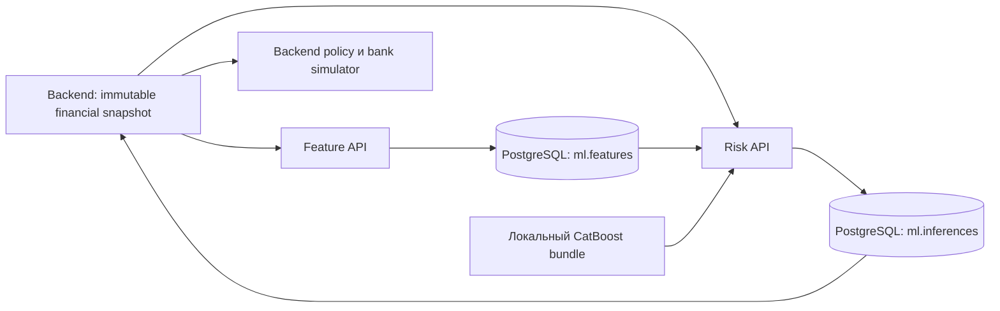

# Архитектура скоринга

Назначение: архитектура скоринга.

Статус реализации: отдельный локальный ML-сервис; публичный backend и frontend не поставляются. Статус проверки документации — в [verification.md](verification.md).

Актуальность: 22.10.2026. Исходный проверяемый снимок: `ml/local-scoring-runtime` / [`f14d090a956d`](https://github.com/Tonitrus1/ALFA-HACK-2026/commit/f14d090a956d2a9063da57a53c269237b5df6298). Среда исторических runtime-проверок: macOS arm64, Python 3.12.13. При этой миграции сервисы повторно не запускались.

## Компоненты и схема потока запроса

Feature-builder, HTTP inference и долговечные записи реализованы. Policy — отдельный [образец](../../../ml/scoring/demo_policy.py) для backend; ML не принимает банковское решение и не изменяет заявки.

## Алгоритм обработки, правила и fallback

Восемь исходных финансовых значений преобразуются в X1/X2/X3/X4/X7/X8/X9/X10 единым builder для batch и online. Денежные значения — целые копейки после Decimal-конвертации. CatBoost обрабатывает NaN через `nan_mode=Min`, без imputer/scaler. Нельзя передавать target, произвольный score или готовые features.

ML проверяет вход/digest/хронологию и сохраняет снимок; затем вычисляет score из точного снимка. Успех inference возвращается только после commit записи. Недоступность модели/БД — ошибка для backend; fallback MANUAL, без подстановки score=0.

Порог T_manual=**0.03504223273828764**, версия policy **synthetic-demo-policy-3**. Это верхние 20% score среди пригодных validation-примеров для оборотного продукта: 1205 пригодных, 241 на ручную проверку; 38 искусственных событий среди пригодных, 26 среди направленных на проверку; на границе один score. Норматив банка из этого не следует.

Приоритет: ошибка данных → существенное расхождение выручки с reference → жёсткая продуктовая пригодность → отрицательный капитал/долг ≥90% активов → нулевая выручка/неподдерживаемый случай → сбой ML → score≥T_manual → превышение cap → одобрение. Точный эталон в `demo_policy.py` и `local-demo-policy.json`.

cap = min(product.maxAmountMinor, revenueMinor // 4). Ниже минимума продукта оферта не создаётся: MANUAL. Высокий score всегда раньше ALTERNATIVE. Изменение суммы не меняет финансовый score.

| Сценарий | Данные / действие | Проверенный результат |
| --- | --- | --- |
| S01 | Согласованные источники, низкий настоящий score, 200 тыс. RUB | APPROVED |
| S02 | Корректный баланс, обязательства 95% активов | DECLINED до вызова модели |
| S03 | Выручка в декларации ×2 против reference | NEEDS_INFO; коррекция выручки в новом снимке → настоящий inference → APPROVED |
| S04 | Финансы S01, запрос 5 000 000,01 RUB | ALTERNATIVE на допустимую сумму |
| S05 | Другой train-пример, проходящий жёсткие правила, высокий настоящий score | MANUAL |
| S06 | Применимые данные, отказ именно вызова risk после создания признаков | MANUAL без score/inferenceId |

S06 использует явный fault в сценарном клиенте: только risk-запрос конкретной попытки направляется на закрытый локальный порт. Рабочий ML API не читает scenarioId/expectedOutcome и не содержит переключателя подготовленных score. После сценария обычные вызовы продолжают работать.

`ml/fixtures/scenarios.json` содержит маленькие вымышленные входные данные, закреплённый bundleDigest и происхождение из train. `expectations.json` читает только тестовый/сценарный runner. Переименование карточки или изменение допустимых финансов не фиксирует маршрут: исход снова вычисляется. Для RFI backend хранит исходную reference-версию; коррекция создаёт amendment и новую попытку, исходный пакет неизменяем.

CLI проверяет путь до решения policy. REVIEW/ACCEPTED/COMPLETED, операторское решение, expiry/cancel и банковские оферты описаны для реализации коллегами; из наличия ML-сценария они не считаются готовыми.

## Хранение и модель данных

Источник финансового состояния заявки — backend, источник точных feature/inference records — PostgreSQL `ml.features`/`ml.inferences`. Миграция — [V1__ml.sql](../../../ml/migrations/V1__ml.sql). Runtime-роли доступны SELECT/INSERT; обновление записей не используется. Перезапуск процесса не должен удалять результаты. Веса/manifest — файловый bundle, `.local` — локальная инфраструктура, не источник бизнес-решений.

## Версионирование

Активен `catboost-optuna-v1`, featureSchemaVersion=2, policy `synthetic-demo-policy-3`. Полные digests находятся в [manifest](../../../ml/artifacts/baseline/manifest.json), версии не копируются в конфигурацию вручную. Ответ привязан к featureSnapshotId/digest, requestId, bundleDigest и modelVersion. Изменение суммы заявки не меняет финансовый score.

## Параллельность и лимиты

Feature identity — `(submissionSnapshotId, featureCodeDigest)`; requestId идентифицирует одну оценку. PostgreSQL advisory locks и уникальные ограничения защищают конкурентные точные повторы. Timeout соединения/statement в ML — 2 секунды; клиент задаёт timeout=3 на отдельный HTTP-вызов. Это не end-to-end deadline: общий бюджет 3 секунды контролирует backend. Нагрузочная ёмкость нескольких клиентов не измерена.

## Внешние зависимости и границы доверия

PostgreSQL и локальные проверенные артефакты. Все прикладные endpoints, включая health, требуют Bearer; frontend обращается к backend. Model serialization загружается только из доверенного локального bundle с корректными hash/версиями. Нет внешнего LLM и платных сетевых API.

## Связь с общей архитектурой и расхождения

[Общий внутренний API](../../architecture/contracts/internal.openapi.json), [реализованный профиль](../../architecture/contracts/local-risk-profile.json). Остальная архитектура — спецификация; UI, application/outbox, оферты и банк не реализованы этой поставкой. В этом снимке нет `active-bundle.json`, команд activate и отдельного кандидата; более поздние интеграционные эксперименты не перенесены при оформлении.
