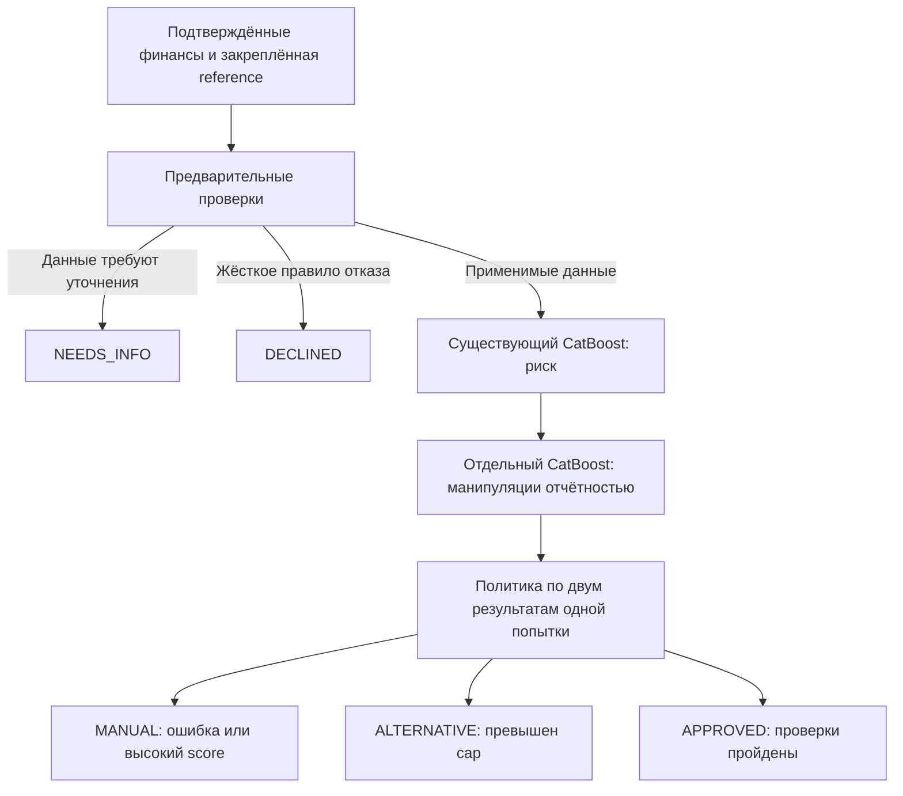

# Две модели и политика шести сценариев

Актуальность: 22.10.2026, ветка `ml/local-scoring-runtime`. Реализованы и проверены локальный API, PostgreSQL и исполняемый образец backend policy. Публичный кабинет, процесс заявки и выпуск банковской оферты остаются работой backend/frontend.

## Что перенесено из исследования

Из исследования взято разделение кредитного риска, антифрода и политики решений. Две независимые модели возвращают непрерывные оценки; политика не усредняет их и не обучается на исходах S01–S06. Новая инфраструктура, банковская PD, LGD/EAD, pricing, транзакционные модели и внешние источники не добавлялись.



Последовательность HTTP-вызовов связывает fraud inference с уже сохранённым risk inference. Результат одной модели не заменяет отсутствующий результат другой.

## Модели и данные

| Компонент | Вход и назначение | Артефакты |
|---|---|---|
| `catboost-optuna-v1` | Восемь прежних коэффициентов; синтетический proxy банкротства | `ml/artifacts/baseline/`, все файлы сохранены побайтно |
| `catboost-manipulation-v1` | 16 подписанных/абсолютных нормированных расхождений восьми финансовых значений с reference | `ml/artifacts/fraud-demo-v1/` |
| Политика | Два независимых score, продукт, сумма, результаты предварительных проверок | `synthetic-dual-policy-4`, policy внутри fraud bundle |

`delta=(declared-reference)/max(abs(reference),100 копеек)`. Reference предоставляет доверенный backend. Модель не обнаруживает совместную подмену заявления и reference.

Исходная выборка: 10 000 вымышленных компаний, train/validation/test = 7016/1494/1490. Для каждого исходного примера создаются семь заявлений: неизменённое, три допустимые корректировки и три манипуляции. Всего 49 112/10 458/10 430 пар. Допустимые изменения пересекаются с атаками по направлению и величине; изменения составляют 1–19%. Баланс сохраняется, как и исходная принадлежность компании к split.

Новый target — намерение **генератора**, не `target_12m`. Веса кредитной модели и её порог не менялись. Компания/семейство атаки/метки/генераторная истина не входят в признаки. Разбиение всех вариантов компании групповое. Дополнительный test содержит 1490 комбинированных манипуляций с увеличением активов и прибыли; это семейство не встречается в обучении.

Симуляция и hashes: [manifest](../../../ml/experiments/fraud-demo-v1/manifest.json). Данные находятся рядом в Parquet. Генератор — `ml/scoring/fraud_data.py`, обучение — `ml/scoring/fraud_train.py`. Модель — CatBoost, 350 деревьев, глубина 4, seed 42; generator seed 20261022. Артефактный [selection lock](../../../ml/artifacts/fraud-demo-v1/selection-lock.json) записан до открытия test; `testOpened: false` означает состояние на момент фиксации, а не отсутствие последующей оценки.

## Качество и границы интерпретации

Порог выбран только на validation: максимальный recall при односторонней верхней 95% Wilson-границе FPR не выше 5%, сравнение `>=`. Это демонстрационный бюджет, не банковский норматив. Оценка ниже рассчитана на примерах, прошедших все существующие предварительные правила.

| Метрика | Validation | Test |
|---|---:|---:|
| Пригодных заявлений | 8490 | 8510 |
| Precision | 88,00% | 88,61% |
| Recall манипуляций | 41,61% | 41,75% |
| FPR на допустимых заявлениях | 4,46% | 4,22% |
| Дополнительно выявлено манипуляций сверх кредитной ручной проверки | 1212 | 1198 |
| Доля MANUAL до → после | 19,73% → 36,02% | 21,69% → 37,50% |

[Полный отчёт](../../../ml/artifacts/fraud-demo-v1/evaluation.json). Доля fraud в симуляции задана генератором; precision и доли MANUAL не являются прогнозом для реального потока. При 5% FPR верхняя граница относится только к синтетической validation-популяции, не к новым данным.

**Отдельное невиданное семейство не обнаружено: recall 0/1335 пригодных примеров.** Поэтому перенос на новые манипуляции не подтверждён. Модель не может установить умысел по расхождению финансов и не имеет подтверждённых реальных fraud-меток. Тип score — `SYNTHETIC_MANIPULATION_PROXY`, статус — `DEMONSTRATION`, purpose — `DEMO_RESEARCH`.

Подключение к демонстрационной политике разрешается только при FPR ≤5% на validation и test и дополнительном выявлении сверх кредитной ручной проверки в обеих частях. Этот критерий пройден. Первоначальная реализация по ошибке добавляла отдельный критерий положительного recall невиданного семейства; он исключён как отсутствующий в согласованном плане. Это изменение критерия сделано после просмотра оценки и явно записано в `protocolNote`; модель, порог и все оценки не менялись. [Исходный исследовательский отчёт с более строгим gate](../../../ml/experiments/fraud-demo-v1/exploratory-evaluation.json) сохранён. Нулевой recall не скрывается и ограничивает применение.

Для настоящего антифрода потребуются исторические заявления, доступные на момент заявки независимые reference-версии, подтверждённые исходы расследований, легитимные исправления и временная проверка. На текущем наборе одна дата оценки; временная устойчивость не проверяется.

## Политика и сценарии

Существующие предварительные правила сохраняются: некорректные данные/существенное расхождение выручки → NEEDS_INFO; объяснение после RFI → MANUAL; пригодность продукта и отрицательный капитал/обязательства ≥90% активов → DECLINED; неподдерживаемый продукт/нулевая выручка → MANUAL.

После них `after_models` требует обе корректные оценки. Ошибка/нет результата → MANUAL; высокий fraud → MANUAL с `SUSPECTED_FINANCIAL_MANIPULATION`; высокий кредитный score → MANUAL с `MODEL_REVIEW_BUDGET`; при двух срабатываниях сохраняются обе причины. Далее прежний cap: `min(product.maxAmountMinor,revenueMinor//4)`, ниже минимума → MANUAL, превышение → ALTERNATIVE, иначе APPROVED.

| Сценарий | Проверенное поведение |
|---|---|
| S01 | Низкие обе оценки → APPROVED |
| S02 | Жёсткое правило → DECLINED без моделей |
| S03 | NEEDS_INFO → исправленные данные в новой попытке → APPROVED |
| S04 | Низкие обе оценки, превышение cap → ALTERNATIVE |
| S05 | MANUAL: отдельно кредитный риск, отдельно манипуляция, оба фактора |
| S06 | MANUAL при отказе отдельно risk и отдельно fraud |

Основные шесть сценариев сохранены; варианты S05/S06 не добавляют новых бизнес-исходов. Примеры с высоким fraud-score выбраны из train по настоящим предсказаниям. Рабочие endpoints не принимают scenarioId, score, target или переключатель исхода. Fault injection существует только в сценарном клиенте.

## Контракт и интеграция

Все прежние risk endpoints сохранены. Расширение — отдельный [fraud OpenAPI](../../../ml/fraud.openapi.json), полный runtime-контракт — [OpenAPI](../../../ml/openapi.json). Большой архитектурный комплект/PDF остаётся исторической спецификацией; новые fraud-операции описаны этим дополнением.

| Операция | Назначение |
|---|---|
| GET `/internal/v1/fraud/bundle` | Закрепить manifest и новую policy на попытку |
| POST `/internal/v1/fraud/feature-snapshots` | Сохранить признаки заявления относительно доверенной reference |
| GET `/internal/v1/fraud/feature-snapshots/{id}` | Получить точный неизменяемый fraud-снимок |
| POST `/internal/v1/fraud/evaluations` | Сохранить fraud inference, связанный с risk inference той же попытки |

Backend сначала сохраняет исходную reference и её источник. После precheck создаёт прежний risk snapshot и risk inference. В fraud snapshot передаёт исходное тело risk snapshot request плюс `riskFeatureSnapshotId`, `referenceSnapshotId`, `referenceSnapshotDigest`, `referenceAvailableAt`, `referenceStatement`. Сервер сверяет полное исходное тело с input_hash сохранённого risk snapshot, включая application/submission IDs, суммы и времена.

Fraud evaluation получает собственные snapshot ID/digest, fraud bundleDigest, `featureSchemaVersion=1`, `riskInferenceId` и тот же requestId, что у risk inference. Сервер сверяет requestId, risk snapshot и закреплённый risk bundle. Подмена reference при той же identity, конфликт тела повтора или смешивание попыток даёт 409. Неизвестный ID → 404, невалидный ввод/будущий источник → 422, нет авторизации → 403, ошибка БД/запрещённый gate → 503. Примеры — [fraud examples](../../../ml/examples/fraud/).

Миграция `V2__fraud.sql` добавляет `ml.fraud_features` и `ml.fraud_inferences`, immutable triggers и SELECT/INSERT для runtime-роли. Успех возвращается после commit. Версии двух моделей, digests снимков и policy закрепляются на попытку. Публичный frontend не получает внутренние пороги и fraud-диагностику.

Образец оркестратора — `DecisionClient`. Он уменьшает оставшийся timeout для каждого вызова в общем бюджете 3 секунды и не принимает запоздалый ответ как основание одобрения. Нет score=0 при сбое. Реальный backend дополнительно отвечает за CAS/state machine: отменённая или заменённая попытка не должна получить оферту из позднего ответа. Сумма заявки влияет только на policy, а исправление финансов создаёт новую попытку и снимки.

## Запуск и проверки

ОС: macOS arm64, Python 3.12.13, PostgreSQL 17.5; POSIX shell, корень репозитория. Сначала штатный setup, затем миграция V2 и запуск. Обученные веса и пары уже поставлены, скачивание/обучение при запуске не выполняется.

```sh
./scripts/demo migrate
./scripts/demo up --offline
./scripts/demo test
./scripts/demo scenarios
PYTHONPATH=ml .venv/bin/python scripts/verify_dual_runtime.py
```

Тесты/сценарии добавляют вымышленные записи. Runtime verifier перезапускает только выделенный стенд и моделирует отказ записи. Результаты: [тесты](../../../reports/ml-tests.xml), [сценарии](../../../reports/dual-model-scenarios.json), [runtime](../../../reports/dual-model-runtime.json). Проверены неизменность кредитного bundle относительно Git HEAD, сохранность обоих inference после рестарта, реальные ошибки записи каждой модели, восстановление, immutable-записи и запрет внешней сети. Сквозная приёмка с настоящим frontend/backend не выполнена.

Стандартные порты 8001/55432. На данном компьютере они были заняты другим стендом, поэтому новая изолированная конфигурация использует 8002/55433. При первичном создании конфигурации порты можно задать `ML_API_PORT`/`ML_DATABASE_PORT`; они сохраняются в секретном `.local/runtime.json`. Его содержимое не публикуется. В локальной проверке переиспользованы уже установленные зависимости и PostgreSQL, свежая установка пакетов не проверялась.

Для нового эксперимента (существующий каталог не перезаписывается):

```sh
./scripts/demo train-fraud --output ml/artifacts/fraud-experiment-next
```

Команда обучает только fraud-модель и сохраняет парную симуляцию в `ml/experiments/<имя bundle>/`. Она не активирует новый bundle. Для ручного serving после проверки нового эксперимента задаётся `FRAUD_MODEL_BUNDLE`; смена требует остановки процесса, проверки gate/совместимости и повторной приёмки. Автоматического promotion нет.
