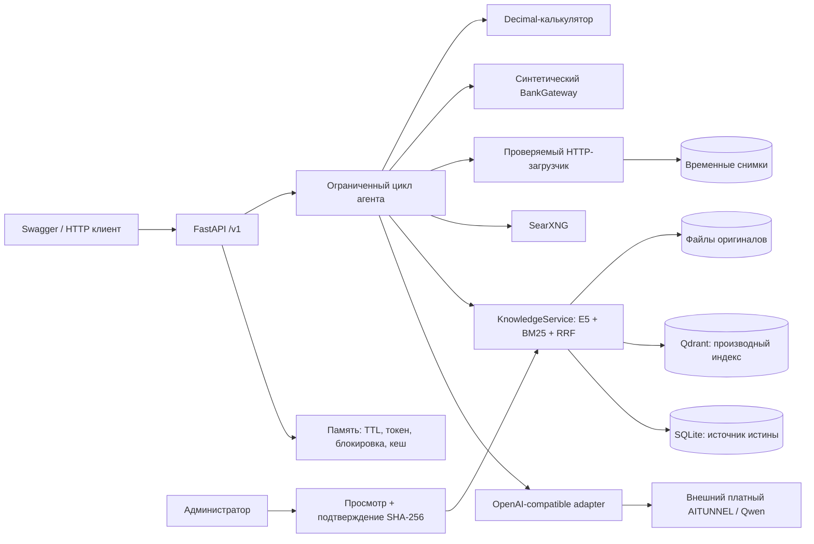
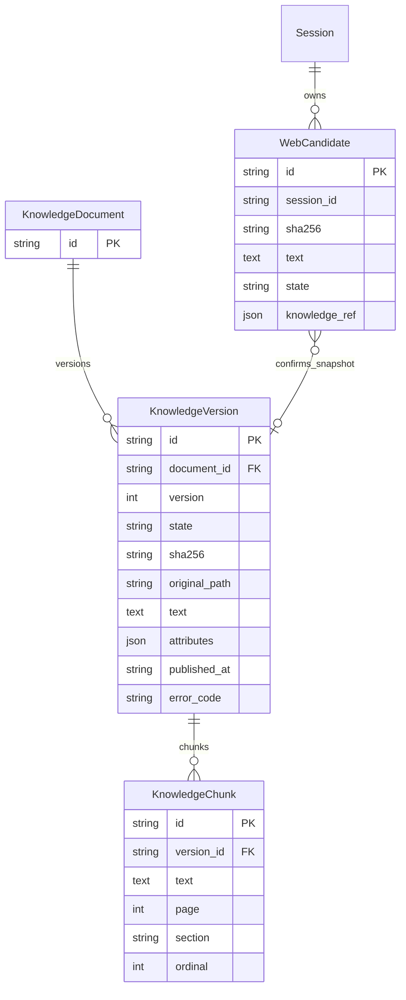
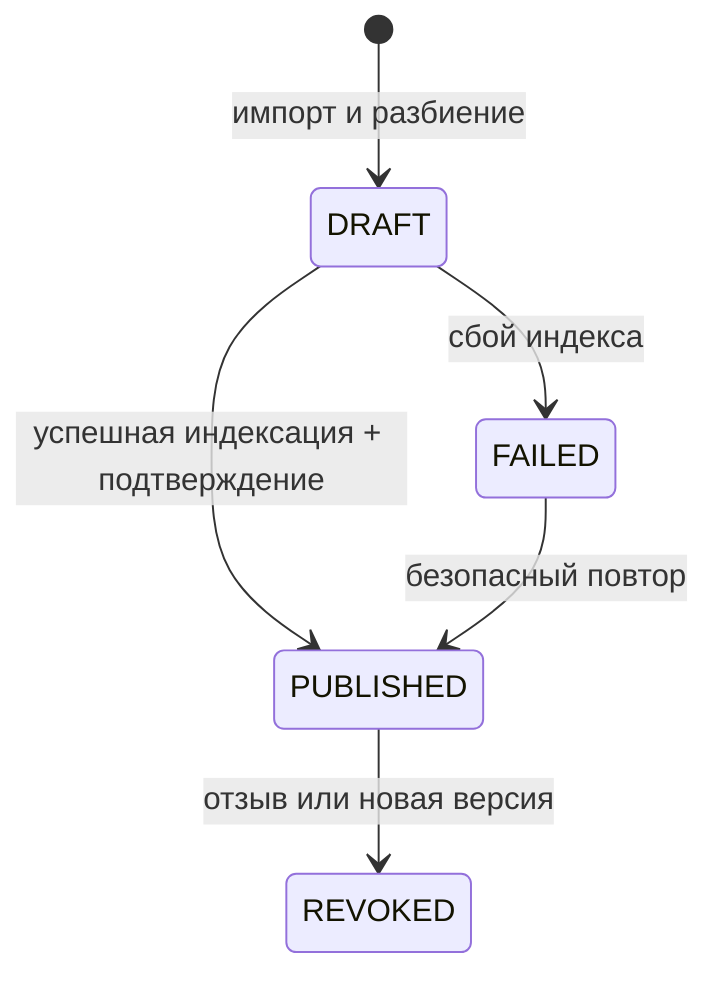

# Архитектура сервиса

Интерфейсы `LLMClient`, `SessionStore`, `KnowledgeRepository`, `VectorIndex`,
`WebSearch`, `BankGateway` находятся в `interfaces.py`. API / orchestrator принимают
реализации через фабрику приложения. Обычные тесты подменяют внешние зависимости.
Ни один инструмент не отправляет заявку и не меняет кредитное решение.

Session - только память процесса; её связь с кандидатом не является внешним ключом БД.
После рестарта все незавершённые кандидаты удаляются. Подтверждённые знания остаются.
Версионный номер уникален в пределах документа. Содержимое версии и исходный файл
неизменяемы; состояние и время публикации обновляются.

Публикация, отзыв, ingestion и поиск согласуются `threading.RLock` в одном процессе.
До commit PUBLISHED в SQLite Qdrant должен подтвердить запись всех фрагментов.
Частично записанные точки FAILED/DRAFT никогда не участвуют в поиске: dense фильтрует
по списку активных version_id из SQLite, BM25 строится из того же набора. Старые точки
могут оставаться в Qdrant до reindex, но недоступны поиску. Сверка при старте полностью
перестраивает индекс. Перед выдачей ответа версии перепроверяются. Ходы, контекст которых
зависел от уже неактивной версии, целиком исключаются из последующих LLM-запросов,
включая сохранённые результаты инструментов. Публичная история сессии остаётся доступной
до её закрытия или TTL.

CPU embeddings, parsing, BM25 и SQL-операции выполняются в ограниченном AnyIO thread
pool. Источники ранжируются двумя top-10 ветками и RRF(k=60), top-5. Порог dense
подбирается CLI на опубликованном стартовом корпусе; без измерения dense выключен.
Отдельный запрос к LLM для query expansion или суммаризации не выполняется.

Состояния синтетических заявок не изменяются сервисом: `DOCUMENTS_REQUIRED`,
`UNDER_REVIEW`, `APPROVED`, `DECLINED` читаются из fixtures. Полная диаграмма кредитного
процесса находится в существующей архитектуре основного проекта.
