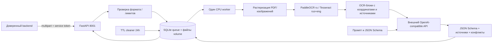
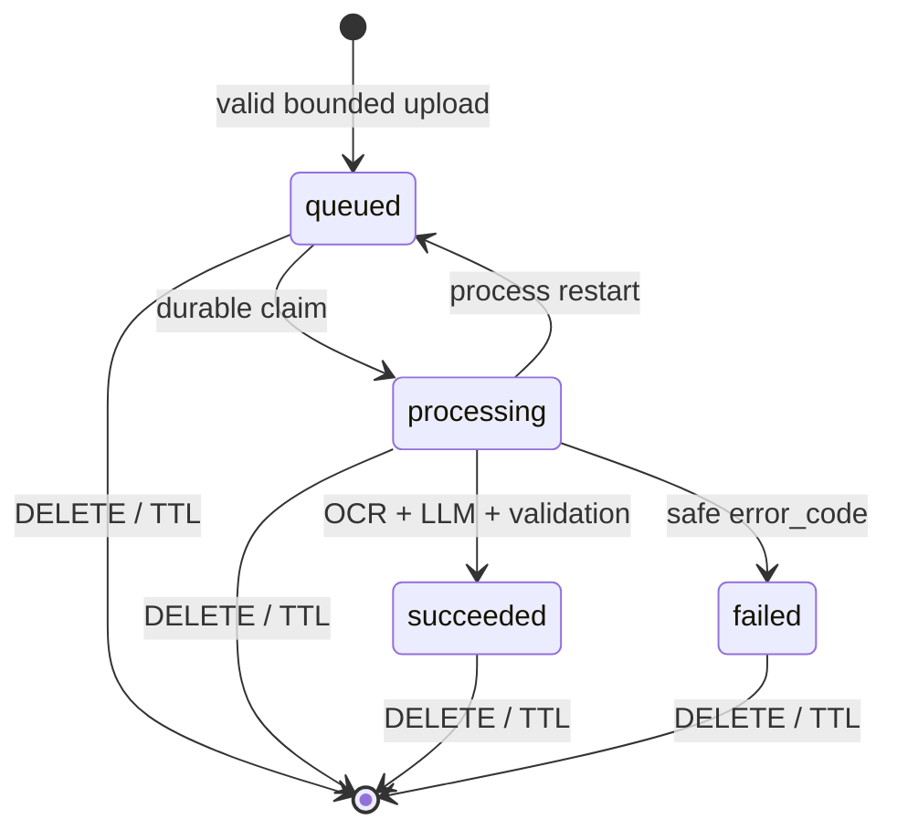

# Архитектура самостоятельного модуля

Модель хранения: jobs(id,status,expires,body JSON metadata) и каталог jobs/id
с файлами document_id, contract.json, ocr.json, result.json. В очереди только
неизменяемые UUID и SHA256 файлов; исходные имена не используются как пути.
Результат содержит hashes контракта, версии OCR, модель и usage LLM.
Весовые SHA256 записаны отдельно при подготовке образа.

Загрузка сначала идёт в staging. После проверки всего пакета каталог атомарно
переименовывается, затем создаётся запись очереди. Незавершённый staging убирается
при рестарте; промежуток между rename и INSERT покрывается очисткой сирот по TTL.
Публикация JSON — через os.replace. DB транзакция не удерживается во время OCR/HTTP.

При интеграции backend обязан связать document_id с CLEAN objectVersion,
проверить полномочия пользователя/компании и TTL, сопоставить поля с финансовым
контрактом и запросить подтверждение. Публичные схемы проекта этим модулем
не переопределяются. OCR READY и AV CLEAN — разные состояния.
